# SubmitIQ: Insurance Submission Intake Agent

Commercial P&C underwriters spend much of their day re-keying broker submissions: an
email, an ACORD-style application, carrier loss runs, and a statement of values (SOV).
SubmitIQ reads the whole package and returns:

1. **A structured submission record**: 70 field types across insured, broker, policy, coverage,
   per-location COPE, every claim, every policy year, and totals. **Every value carries a confidence
   score and a citation** (document, page, quoted text).
2. **An appetite decision** (accept / refer / decline) from a **deterministic rules engine**
   over `rules/appetite.yaml`. Each reason names the fields it relied on.
3. **A one-page triage summary** in which every fact cites its field. A validator rejects any
   narrative that cites a missing field or uses a number it cannot trace back.

Anything uncertain (low confidence, a cross-document conflict, a failed reconciliation, a missing
required field) goes to a **human review queue** instead of passing silently.

> **Status, honestly.** Every number below comes from the eval harness (`evals/run.py`); nothing was typed in by
> hand. There are two kinds of columns. **Offline** columns were measured with the replay backend before any model
> answers were recorded: it *abstains* on every LLM call, so they measure the deterministic parts only (parsers,
> normalization, consistency checks, routing, rules). **Claude** columns are live runs on the 40-submission held-out
> test split, with the model named in each column (Haiku 5.5 for the baseline, Sonnet 5.5 for the final pipeline;
> about $3 for both). Their answers are recorded in `fixtures/replay/`, so CI replays them offline. Two demo fixtures
> are **hand-written** and labelled `hand_written` wherever they appear.

## Quickstart (offline, about 3 minutes)

```bash
make setup     # venv + dependencies (also needs Tesseract: brew install tesseract / apt-get install tesseract-ocr)
make eval      # final pipeline on the 40-submission test split, replay backend
make demo      # one package end to end: decision, flags, cited summary
```

Then `make seed && make serve` opens the review UI at http://localhost:8000.
`make test` runs 51 tests, `make synth` synthesizes the AWS stack, and `make eval-all` reruns every variant.

## Architecture

```mermaid
flowchart LR
  subgraph Package["Broker package"]
    E[email.txt]; A[application PDF<br/>ACORD 125/140-style]; L[loss run PDFs]; S[SOV xlsx / PDF]
  end
  Package --> X["Text extraction<br/>pdfplumber words · Tesseract OCR<br/>(orientation + deskew, cached)"]
  X --> C["Classify<br/>keyword rules → LLM if unsure"]
  C --> P1["Layout parsers<br/>form labels · table bands<br/>(SOV, loss runs, premises)"]
  C --> P2["Claude tool use<br/>strict JSON schema per doc type<br/>value + page + evidence"]
  P1 & P2 --> M["Merge by source-of-truth rules<br/>SOV > application for COPE · loss run for claims"]
  M --> V["Validate<br/>cross-doc conflicts · reconciliations<br/>plausibility · entity normalization"]
  V --> K["Confidence + routing"]
  K --> R["Rules engine<br/>rules/appetite.yaml"]
  R --> N["Triage summary<br/>Claude narrative, citation-validated<br/>(template fallback)"]
  K -- "flagged" --> Q[["Review queue + UI<br/>corrections → new eval cases"]]
  N --> O[(record · decision · summary)]
```



On AWS (`infra/`, CDK): **S3 intake** → EventBridge on `incoming/*/manifest.json` → **Step Functions**
(`classify → extract → validate → rules → summarize`, each a container-image **Lambda**) → **Bedrock**
for Claude → **DynamoDB** records, with KMS encryption, CloudWatch EMF metrics, a dashboard and alarms. Each
Lambda calls the same `Pipeline` step the evals measure. See [`docs/deploy.md`](docs/deploy.md).

Model backends, all behind one interface (`submitiq/llm/`): `anthropic` (official SDK, strict tool
schemas, refusal fallback), `bedrock` (boto3 InvokeModel), and `replay` (recordings on disk; misses abstain
and never invent an answer). `SUBMITIQ_RECORD=1` turns any live run into replay fixtures, so CI stays offline and deterministic.

## Results

Synthetic data: 120 packages (`data/generate.py`), split dev 80 / test 40. Application **template C appears only in
test**: it's a layout the deterministic form parser has never seen. Realistic mess is built in: scanned/skewed/rotated
pages, split tables, name variants, broker abbreviations, missing fields and planted cross-document conflicts.

<!-- RESULTS:START -->
| test split (40 submissions) | Baseline, offline | Final, offline | Baseline, Claude | Final, Claude |
|---|---|---|---|---|
| Model | none (offline) | none (offline) | claude-haiku-5-5 | claude-sonnet-5-5 |
| Field F1 (all fields) | 0.0 | 96.1 | 83.3 | 99.8 |
| Critical-field F1 | 0.0 | 98.9 | 84.0 | 100.0 |
| F1 on held-out template C | 0.0 | 84.5 | 96.3 | 99.8 |
| Appetite decision accuracy | 0.0 | 87.5 | 65.0 | 100.0 |
| Declines predicted as accept | 0 | 0 | 0 | 0 |
| Review-queue rate | 100.0 | 57.5 | 30.0 | 67.5 |
| Silent critical-error rate | 0.0 | 0.0 | 5.0 | 0.0 |
| Conflict detection P / R | 0.0 / 0.0 | 90.9 / 50.0 | 0.0 / 0.0 | 65.5 / 95.0 |
| Latency p50 / p95 (s; offline columns exclude LLM) | 0.17 / 9.1 | 0.19 / 9.1 | 19.28 / 31.2 | 24.44 / 33.5 |
| LLM latency per submission (s) | 0.0 | 0.0 | 17.6 | 22.9 |
| LLM cost per submission (USD) | 0.000 | 0.000 | 0.003 | 0.073 |
| LLM calls per submission | 1.0 | 3.0 | 1.0 | 3.0 |

<sub>Generated by scripts/results_table.py from evals/results/ (git 455650f, e384c5f).</sub>

| dev split (80 submissions) | Baseline, offline | Final, offline | Baseline, Claude | Final, Claude |
|---|---|---|---|---|
| Model | none (offline) | none (offline) | — | — |
| Field F1 (all fields) | 0.0 | 99.2 | not run | not run |
| Critical-field F1 | 0.0 | 99.7 | not run | not run |
| F1 on held-out template C | n/a | n/a | not run | not run |
| Appetite decision accuracy | 0.0 | 100.0 | not run | not run |
| Declines predicted as accept | 0 | 0 | not run | not run |
| Review-queue rate | 100.0 | 42.5 | not run | not run |
| Silent critical-error rate | 0.0 | 0.0 | not run | not run |
| Conflict detection P / R | 0.0 / 0.0 | 88.9 / 82.0 | not run | not run |
| Latency p50 / p95 (s; offline columns exclude LLM) | 0.13 / 8.5 | 0.20 / 8.5 | not run | not run |
| LLM latency per submission (s) | 0.0 | 0.0 | not run | not run |
| LLM cost per submission (USD) | 0.000 | 0.000 | not run | not run |
| LLM calls per submission | 1.0 | 3.0 | not run | not run |

<sub>Live runs cover the held-out test split only; the dev split was used while building.</sub>

<sub>Generated by scripts/results_table.py from evals/results/ (git e384c5f).</sub>
<!-- RESULTS:END -->

**How the system got here** (offline, test split; full story with dev numbers and what broke at each step in
[`docs/experiment_log.md`](docs/experiment_log.md)):

| step | field F1 | decision acc. | review rate | silent critical errors |
|---|---|---|---|---|
| Stage 3 baseline: one Claude call | 0.0 (all calls abstain offline) | 0.0 | 100 | – |
| 4a table-aware SOV / loss-run parsing | 80.2 | 0.0 | 100 | – |
| 4b per-document extraction (layout parsers + Claude tool use) | 94.0 | 0.0 | 0.0 | **67.5** |
| 4c consistency checks, no normalization | 94.0 | 0.0 | 72.5 | 25.0 |
| 4c + entity / value normalization | 96.1 | 0.0 | 25.0 | 27.5 |
| 4d confidence scoring + review routing | 96.1 | 0.0 | 57.5 | **0.0** |
| 5 deterministic rules engine + cited summary | 96.1 | **87.5** | 57.5 | 0.0 |

What to take from it:
* The most important line is **silent critical errors: 67.5% → 0%**. After 4d, no test submission with a wrong or
  missing critical field avoids review. That costs review volume. Most of the 57.5% is the held-out template C,
  whose application fields are unreadable offline. Those *should* go to a person until the Claude path is measured.
* All 5 test decision errors are template-C packages referred for missing NAICS: the safe direction. **0 declines
  were ever predicted as accept.**
* The offline F1 on templates A/B (≈99%) measures a parser I wrote against templates I also wrote. Template C
  (84.5%) is the honest number, and closing that gap is what the Claude extractor is for.

What the live runs (test split) add:
* **Template C: 84.5 → 99.8 F1** with Claude reading the unseen layout. Decision accuracy **87.5 → 100%**, silent
  critical errors stay at **0%**, and no decline is ever predicted as accept.
* **The single-call baseline is clearly worse**: 83.3 field F1, 65% decision accuracy (12 of 40 packages came back
  with no usable decision), no conflict detection at all, and a **5% silent critical-error rate**. That gap is the
  case for per-document extraction, cross-checks and rules.
* **Review rate rose from 57.5% to 67.5%.** Once Claude reads template C, its application values can be compared with
  the SOV, so far more planted conflicts are caught (conflict recall 50 → 95%). But about a third of conflict flags
  are false alarms (precision 65.5%). Cutting those is the next target, measured on dev.
* **The citation validator caught my own parser, then the model.** On the first live run 39 of 40 Sonnet narratives
  were rejected and replaced by the template summary, yet the metric said "citations valid: 100%" because it scored
  the final summary, template included. Two fixes: the validator now reads grouped citations (`[a.b; c.d]`, which
  is how the model writes them) while still requiring every number to trace to a cited field, and the harness now
  reports `llm_narrative_accept_rate`. Re-scored on the recorded answers: **29 of 40 (72.5%) narratives pass**. The
  other 11 really do state an uncited number (a street address, a loss ratio the model recomputed) and fall back to
  the template, which is the intended behavior.
* **Cost: $0.073 per submission** on Sonnet 5.5 (3 calls, ~14K input / ~4.5K output tokens), about 23 s of model time.
  The Haiku baseline costs $0.003. `scripts/cost_estimate.py` turns the measured tokens into a monthly AWS estimate.

### Manual vs automated triage time

| | manual today | SubmitIQ |
|---|---|---|
| reading + keying + reconciling + loss math + appetite check | **70–140 min** (assumption, `docs/underwriting_workflow.md`) | **24 s p50 / 33 s p95 measured** end to end with Claude (0.2 s / 9 s without the model, incl. OCR) |
| human time per submission | all of the above | ~10 min to clear a flagged submission (57.5% of test packages offline, 67.5% with Claude), ~2 min to confirm a clean one: **≈ 5–7 min expected** (assumption, not measured) |

The human-time row is an assumption to validate with the client in a pilot. The UI logs every correction, so a pilot can measure it.

## Produce the real model numbers

On a laptop with an API key. The cheap path costs a few dollars:

```bash
git clone <this repo> && cd submitiq
make setup
export ANTHROPIC_API_KEY=sk-ant-...         # or: ant auth login
make eval-smoke                             # 5 submissions on Haiku, nothing recorded: checks the key for cents
make eval-live-cheap                        # test split only: baseline on Haiku, final on Sonnet (~160 calls)
.venv/bin/python scripts/results_table.py   # fills the "Claude" columns above, with the model used for each
.venv/bin/python scripts/cost_estimate.py evals/results/<latest>_final_test_anthropic.json   # measured cost
```

Each run prints its cost as it goes. Other options:

| command | calls | what it buys |
|---|---|---|
| `make eval-live-cheap CHEAP_MODELS=baseline=claude-haiku-5-5,final=claude-haiku-5-5` | ~160 | cheapest full test-split run |
| `make eval-live-cheap` | ~160 | default: Sonnet on the pipeline that matters |
| `make eval-live SPLITS=test` | ~160 | Opus 5.5 on the test split |
| `make eval-live` | ~480 | Opus 5.5 on dev and test (roughly $40 at list prices, an estimate) |
| `make eval-live-all` | more | every variant; shared calls are reused from the recordings |

Add `LIMIT=10` to any of them to cap submissions per split. A recording is reused only for the same
model, so a cheap trial never stands in for the model a column claims. `BACKEND=bedrock make eval-live`
runs on Bedrock (needs AWS credentials and `SUBMITIQ_BEDROCK_MODEL_ID`). Commit the new
`fixtures/replay/` files and CI will replay the real answers offline. Then refresh the reference with
`python -m evals.gate <run>.json --update`.

## Repository map

| path | what |
|---|---|
| `docs/underwriting_workflow.md` | Stage 0: how triage works today, which fields matter, appetite rules |
| `data/generate.py`, `data/synth/` | Stage 1: synthetic packages + ground truth (`data/submissions/{dev,test}/`) |
| `submitiq/schema.py`, `submitiq/fields.py` | Stage 2: pydantic `Submission`, field registry and groups |
| `evals/` | Stage 2: harness (P/R/F1, decision, review, conflicts, latency, cost), CI gate, `baseline.json` |
| `submitiq/llm/` | anthropic / bedrock / replay backends, recording, pricing |
| `submitiq/documents.py`, `ocr.py`, `classify.py`, `extract/baseline.py` | Stage 3: baseline pipeline |
| `submitiq/tables/`, `extract/` | Stage 4a/4b: table extractor (local + Textract), per-document parsers and tool-use extractors |
| `submitiq/normalize.py`, `consistency.py`, `confidence.py` | Stage 4c/4d |
| `rules/appetite.yaml`, `submitiq/rules_engine.py`, `summary.py` | Stage 5 |
| `service/` | Stage 6: FastAPI, SQLAlchemy (Postgres / SQLite), HTMX review UI |
| `infra/`, `submitiq/aws_handlers.py` | Stage 7: CDK stack, Lambda handlers |
| `docs/experiment_log.md`, `runbook.md`, `interview_notes.md`, `LEARNING_zh.md`, `deploy.md` | Stage 8 |

## Design choices in one paragraph

Rules decide appetite and the LLM never does, because a decision must be reproducible, auditable and changeable by
editing YAML. The LLM handles the long tail: unseen layouts, free-text email facts, OCR-damaged pages, and the narrative.
Deterministic parsers run first where a layout is known, both because they are cheap and because they give an
**independent second reading**. Agreement raises confidence, and disagreement goes to a human. Infrastructure failure (model
down) degrades to "parsers + rules + template summary, flagged" instead of failing or guessing. Details and trade-offs:
[`docs/interview_notes.md`](docs/interview_notes.md).
